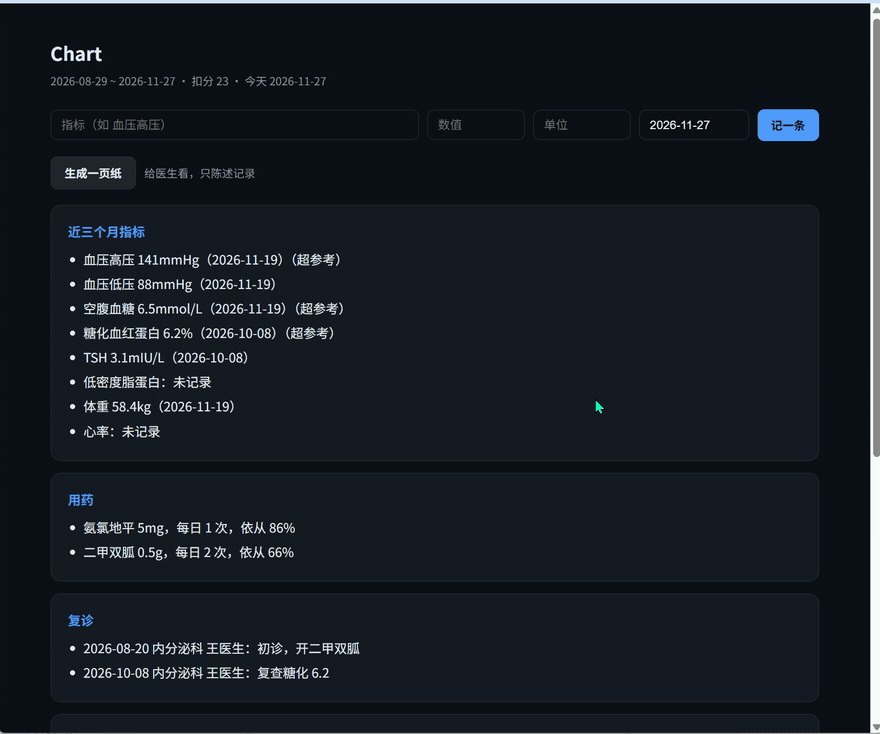
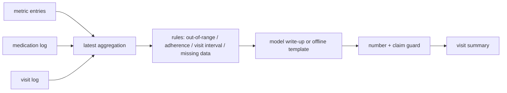

# Chart · health log

[](https://github.com/wushiyi105-jpg/chart/actions)

[](./LICENSE)



Three months of metrics, medication and visits, compressed into one page for the doctor.

## Features

- Aggregates 8 chronic-condition metrics, keeps the latest value and marks out-of-range ones.
- Computes adherence from prescribed days × daily doses versus logged doses; below 80% is flagged.
- Flags a visit interval beyond 90 days, and writes “not recorded” instead of guessing.
- Two guards: numbers must be traceable, and any line containing advice/diagnosis words is dropped.

Rules live in `chart/domain/rules/`; the CLI and the web layer only call them. The Chinese README lists every `rule_id` with its penalty.

## Quickstart

```bash
pip install -e ".[dev]"
python -m chart seed
python -m chart summary --day 2026-11-27
python -m chart compose --day 2026-11-27
python -m chart serve        # http://127.0.0.1:8012
```

Run `python -m chart --help` for the full command list; `docker build -t chart . && docker run -p 8012:8012 chart` works the same way.

## Why not just ask a general LLM

A general model will happily add “suggest a follow-up” — that is the doctor’s job. Chart restricts itself to what is in the record and only orders the facts the way a clinician reads them.

## When to use it

- You are preparing for a chronic-care appointment and the records are scattered.
- You need to show which metric left the reference range and what the adherence rate was.

## Roadmap

- Import CSV from home blood-pressure and glucose meters.
- Push a pre-visit reminder to IM.

## FAQ

**Does it give medical advice?**
No. Lines with advice or diagnosis wording are discarded by the guard.

**Where are the reference ranges?**
`data/ranges.json`; edit them to match your lab report.

**Was the Docker image verified?**
Docker is not installed on the build machine, so `docker build .` was not run and the image is unverified; only the Dockerfile and ports were checked statically.

## Commands

See the Chinese README (`README.md`) for the command table with flags; every command supports `--help`.

## Dependencies

FastAPI + Uvicorn, Jinja2, pydantic / pydantic-settings, httpx, Typer + Rich, SQLAlchemy + Alembic; dev extras add pytest, pytest-cov, respx, freezegun, ruff, mypy, pip-audit. Version pinning lives in `uv.lock`.

## How it works



## Layout

```
chart/
├── .github/
│   ├── ISSUE_TEMPLATE
│   ├── PULL_REQUEST_TEMPLATE.md
│   └── workflows
├── assets/
│   └── demo.gif
├── chart/
│   └── … 9 项
├── data/
│   ├── chart.db
│   ├── ranges.json
│   └── seed.json
├── migrations/
│   ├── __init__.py
│   ├── env.py
│   ├── script.py.mako
│   └── versions
├── prompts/
│   └── summary.md
├── templates/
│   └── index.html
├── tests/
│   └── … 8 项
├── CHANGELOG.md
├── CODE_OF_CONDUCT.md
├── CONTRIBUTING.md
├── Dockerfile
├── LICENSE
├── README.en.md
├── README.md
├── SECURITY.md
├── alembic.ini
├── pyproject.toml
```

## Author

Luo Zhizhi · GitHub [@wushiyi105-jpg](https://github.com/wushiyi105-jpg) · 15071889700
