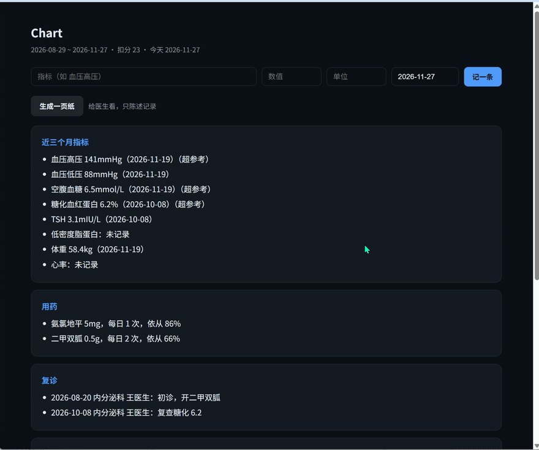
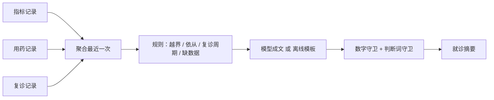

# Chart · 病程记录

[](https://github.com/wushiyi105-jpg/chart/actions)

[](./LICENSE)



三个月的指标、用药、复诊，压成一页纸给医生看。


## 功能特性

1. **指标聚合**：8 个慢病指标，取最近一次，标出超出参考区间的项。
2. **依从计算**：处方天数 × 每日次数 vs 实际记录次数，低于 80% 扣分。
3. **复诊间隔**：超过 90 天周期提示。
4. **缺数据**：最近 7 天一条没记，写「未记录」而不是猜。
5. **双重守卫**：数字可回查；「建议 / 诊断 / 可能是 / 考虑 / 疑似 / 推荐」出现即丢整行。

### 规则与扣分

| rule_id | 含义 | 扣分 |
| --- | --- | --- |
| `metric.out_of_range` | 指标超出参考区间 | 4 |
| `adherence.missed` | 依从率 < 80% | 5 |
| `visit.overdue` | 超过复诊周期 | 3 |
| `data.missing` | 最近 7 天无记录 | 2 |
| `guard.number` | 数字不在记录里，整行丢弃 | 8 |
| `guard.diagnosis` | 出现判断词，整行丢弃 | 10 |

## 快速开始

```bash
pip install -e ".[dev]"
python -m chart seed
python -m chart summary --day 2026-11-27
python -m chart compose --day 2026-11-27
python -m chart serve        # http://127.0.0.1:8012
```

真实种子：12 条指标（血压高压、空腹血糖、糖化、TSH、体重等）、2 种药、2 次复诊。
`summary --day 2026-11-27` 报出 6 项：4 条指标越界（血糖 6.3 / 6.5、糖化 6.2、血压高压 141）、二甲双胍依从 66%、最近 7 天无记录，合计扣 23 分；复诊 50 天仍在 90 天周期内，不提示。

## 为什么不用通用大模型直接问

模型会顺手写「建议复查」——那是医生的活。Chart 把该说的话限定在记录上：指标是否超出参考区间、
依从率多少、距上次复诊几天，全在本地算；模型只把这些事实排成医生习惯读的顺序，
写出来的每一行都要过两道守卫：数字必须在记录里、出现判断词整行删掉。

## 适用场景

- 慢病复诊前，要把三个月的指标、用药、复诊记录压成一页给医生。
- 家里老人记了一堆血压血糖，散在本子上，说不清趋势。
- 需要明确写出「哪项超了参考区间、依从率多少」，而不是让模型自由发挥。

### 边界

- 不做诊断、不给用药建议，导出物只陈述记录；
- 参考区间写在 `data/ranges.json`，按自己的化验单改；
- 数据只在本机 SQLite。

## Roadmap

- 支持血压计 / 血糖仪的 CSV 导入，省掉手抄。
- 复诊前提醒推到 IM，免得又忘。
- 指标趋势图，横向看三个月的变化。

## FAQ

**会给出诊断或用药建议吗？**
不会。出现「建议 / 诊断 / 可能是 / 考虑 / 疑似 / 推荐」的整行会被守卫丢弃。

**参考区间在哪改？**
`data/ranges.json`，按自己化验单上的区间改。

**最近几天没记录会怎样？**
写「未记录」，不猜数。

**Docker 镜像验证了吗？**
CI 的 `docker` job 每次执行 `docker build .`，启动容器并轮询 `/health`；本机没有 Docker，本地未重复跑。

## 命令参考

| 命令 | 作用 | 常用参数 |
| --- | --- | --- |
| `seed` | 写入三个月的指标、用药与复诊。 | --db |
| `metric` | 补一条指标。 | --name, --value, --unit, --day, --db |
| `summary` | 看聚合结果与扣分。 | --day, --db |
| `compose` | 成文（有 key 走模型，否则离线）。 | --day, --db |
| `doctor` | 四项体检。 | --db |
| `serve` | Web 界面。 | --port, --db |

全部命令都支持 `--help`；只读命令不带参数时读默认库 `data/chart.db`，写命令用 `--db` 指到别的库。

## 依赖说明

| 依赖 | 为什么装 | 不装会怎样 |
| --- | --- | --- |
| `fastapi` + `uvicorn[standard]` | Web 入口与 ASGI 服务 | 只有命令行，没有页面 |
| `jinja2` | 服务端渲染模板 | 页面出不来 |
| `pydantic` + `pydantic-settings` | 配置与数据结构校验，`.env` 直接生效 | 配置散在代码里，改端口要改源码 |
| `httpx` | 调模型与 webhook 的 HTTP 客户端 | 模型层与推送都不可用 |
| `typer` + `rich` | 命令行与终端表格 | 只能用 curl 调接口 |
| `sqlalchemy` + `alembic` | 本地库与迁移 | 表结构变更只能删库重来 |
| `pytest` / `pytest-cov` / `respx` / `freezegun`（dev） | 单测、覆盖率、HTTP 打桩、冻结时间 | 规则改动没有回归保护 |
| `ruff` / `mypy` / `pip-audit`（dev） | 风格、类型、依赖漏洞检查 | CI 只看测试，类型错误会漏进主干 |

装了 `uv` 的话，`uv sync --extra dev` 会按 `uv.lock` 装同一套版本。

## 工作原理




domain 里是指标聚合、依从率、复诊间隔与两道守卫；app 负责摘要成文。

## 目录结构

```
chart/
├── .github/
│   ├── ISSUE_TEMPLATE
│   ├── PULL_REQUEST_TEMPLATE.md
│   └── workflows
├── assets/
│   └── demo.gif
├── chart/
│   └── … 9 项
├── data/
│   ├── chart.db
│   ├── ranges.json
│   └── seed.json
├── migrations/
│   ├── __init__.py
│   ├── env.py
│   ├── script.py.mako
│   └── versions
├── prompts/
│   └── summary.md
├── templates/
│   └── index.html
├── tests/
│   └── … 8 项
├── CHANGELOG.md
├── CODE_OF_CONDUCT.md
├── CONTRIBUTING.md
├── Dockerfile
├── LICENSE
├── README.en.md
├── README.md
├── SECURITY.md
├── alembic.ini
├── pyproject.toml
```

## 质量与供应链

- CI 的 Coverage 步骤带 `--fail-under=70`，覆盖率低于 70% 直接失败。
- `tests/test_app_fake.py` 用真实 `InMemoryStore` 跑主用例，并显式标注 `StorePort` 交给 mypy 做结构校验；测试不创建 SQLite 文件。
- Audit 步骤从 `uv.lock` 导出运行时依赖，再用 `pip-audit -r` 审计；开发工具链不进发布物，运行时依赖有漏洞就让 job 失败，不用 `|| true` 吞错。

## 容器验证

镜像由 CI 的 docker job 构建并探活验证；本机未装 Docker。

## 作者

罗之之 · GitHub [@wushiyi105-jpg](https://github.com/wushiyi105-jpg) · 15071889700